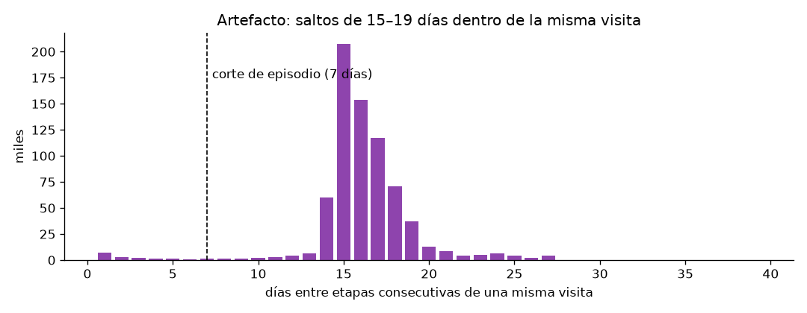
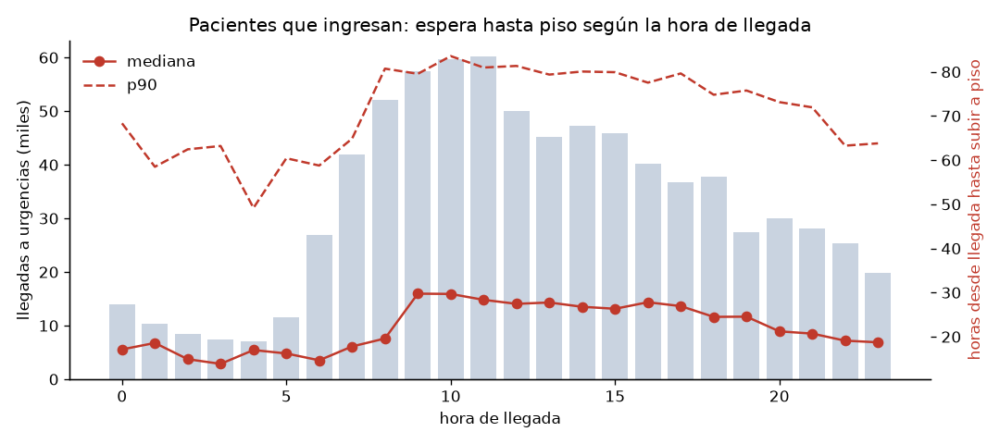
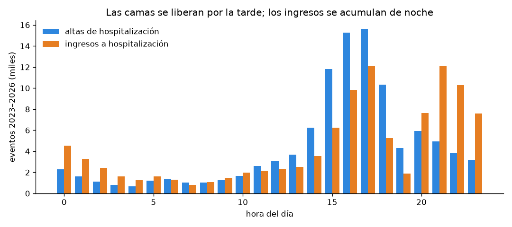
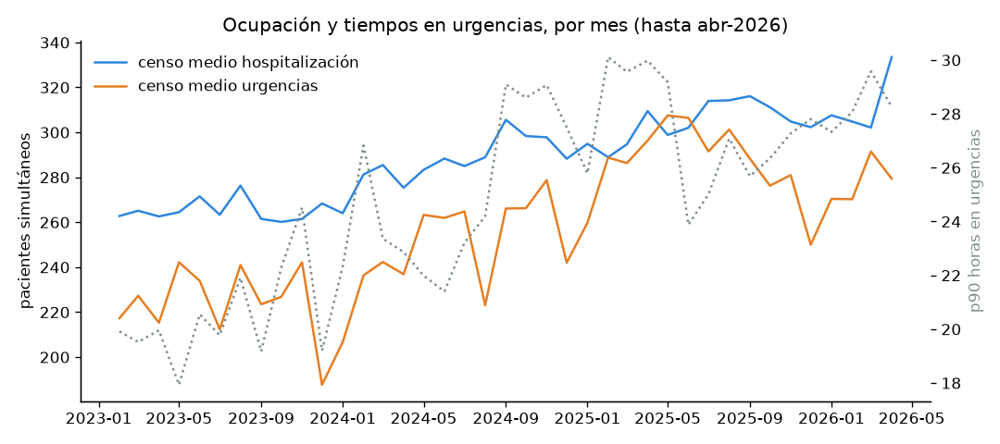
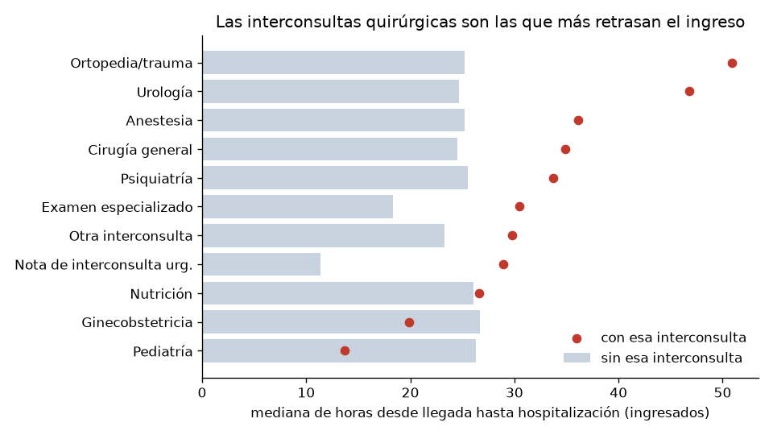
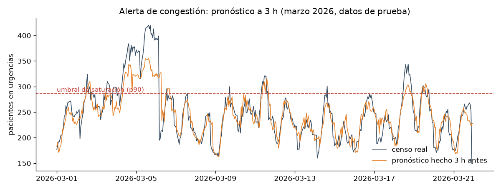
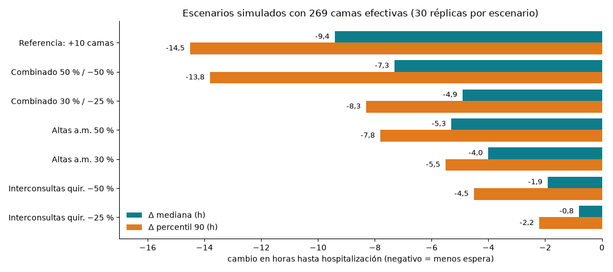

# Data Challenge HUN 2026: flujo de pacientes urgencias → hospitalización
**Equipo DATACHALLENGE_G12**

## Resumen ejecutivo

- **El cuello de botella está en el paso de urgencias a hospitalización.** Los pacientes que ingresan tardan **~23 h de mediana** desde que llegan hasta que se registra su hospitalización (1.375 min, feb-2023 a abr-2026; p90 77 h); el **67 %** de los ingresados supera las 12 h. Con la misma base que Inglaterra (todas las atenciones de urgencias, aquí de 15 min o más), el **43 %** supera las 12 h, frente a ~10 % allí.
- **La causa principal es la capacidad de camas y su liberación tardía.** No conocemos el número real de camas. Una simulación calibrada para reproducir los **tiempos de espera** necesita ~269 camas efectivas, casi igual al censo medio observado (~266, sin UCI): la **capacidad efectiva está saturada** (supuesto S4). Solo el **13 %** de las altas ocurre antes del mediodía (63 % entre las 14 y las 18 h). Por eso quien llega de día espera **28 h**, frente a **16 h** si llega de madrugada.
- **Las interconsultas, sobre todo las quirúrgicas, se asocian con más espera.** Ajustando por edad, sexo, horario, año, censos y UCI (regresión cuantil): ortopedia **+22 h**, urología **+18 h**, cirugía general **+7 h** (en crudo: +26, +22 y +10 h), con un efecto de dosis-respuesta según el número de servicios. Es una asociación, no un efecto causal demostrado (sin nivel de triage no se ajusta por gravedad).
- **Predicción:**
    - Alerta de congestión a **3 h** con precisión 0,80 (IC 95 %: 0,71–0,87) frente a 0,63 si se supone que el censo no cambia.
    - Modelo de ingreso a las 3 h de la llegada con **AUC 0,71** (IC 95 %: 0,70–0,72), bien calibrado; sin diagnósticos con riesgo de fuga, y casi igual sin el número de diagnósticos (0,705). Sirve para **priorizar** a quién gestionar cama, no para saberlo con certeza.
- **Optimización con presupuesto cero:** en una simulación de eventos discretos calibrada con los datos, combinar **altas antes del mediodía (50 %)** con **interconsultas quirúrgicas un 50 % más rápidas** reduce la espera **−7,3 h de mediana y −14 h de p90** con la capacidad calibrada (269 camas efectivas). En el p90 es casi el mismo efecto que **añadir 10 camas** (−13,8 frente a −14,5 h); en la mediana, algo menor (+10 camas: −9,4 h).
    - **Rango de sensibilidad del combinado:** si la capacidad real tuviera más holgura, el efecto baja a **−2,6 h (279 camas) y −1,7 h (289)**. Por separado: adelantar altas va de −4 h a −0,2 h; las interconsultas, de −1,2 a −2,5 h con la capacidad de 2025, aunque en la validación con 2026 su efecto no se distingue de cero (−1,2 h; IC −3,2 a +0,7).
    - El intervalo −7,9 a −6,7 h (30 réplicas) solo refleja la variación aleatoria de la simulación, no la incertidumbre sobre la capacidad real, que es la que domina.
    - **Límite:** la simulación reproduce bien la mediana pero **subestima la cola** (p90 simulado 53 h frente a 77–83 h observado), así que los efectos sobre el p90 son orientativos.
    - **Validación con 2026:** con la capacidad de 2025 la simulación no acierta los valores absolutos de 2026 (la capacidad efectiva bajó). Lo que se sostiene es el **orden** de las medidas: el combinado sigue cerca de +10 camas (−12,9 frente a −14,4 h de mediana).

---

## 1. Problema y contexto

**Objetivo del reto:** comprender, predecir y optimizar el flujo de pacientes, identificando cuellos de botella y oportunidades de mejora en los tiempos de atención.

**Salida de campo (01/10/2026), información del hospital:**

- El problema es la acumulación de pacientes de urgencias combinada con las hospitalizaciones.
- El recurso limitante son las **camas** (básicas, intermedias, intensivas).
- Flujo: triage → zona transitoria → consultorio → observación → hospitalización u otra área.
- Los pacientes de triage 1–3 no pueden devolverse a casa; sin camillas, esperan en sillas.
- Las consultorías (interconsultas) son un cuello de botella.
- Se pide una solución **sin presupuesto o con el menor posible**, y conforme a la ley.

## 2. Datos

Base OMOP-CDM `uninorte_omop`: `person` (912k), `visit_occurrence` (1,7M), `visit_detail` (3,3M), `condition_occurrence` (38,6M), `procedure_occurrence` (47M), `measurement` (16,6M), `concept` y `cups`. Periodo: enero de 2023 a julio de 2026. Se extrajo a Parquet con DuckDB; el texto libre de laboratorio quedó excluido.

### 2.1 Problemas de calidad encontrados y cómo se trataron

| # | Problema | Alcance | Tratamiento |
|---|---|---|---|
| 1 | Saltos de 15–19 días entre etapas de una misma visita | 714.159 de 1.622.681 visitas (44 %) | Se divide en **episodios** cuando hay > 7 días entre etapas (el histograma está vacío entre 2 y 12 días) |
| 2 | `visit_end_datetime` = inicio | 100 % | Las duraciones se calculan con `visit_detail` |
| 3 | `procedure_date` vacío | 47M filas | Los procedimientos se usan a nivel de visita (servicios usados) |
| 4 | Episodios de urgencias de menos de 15 minutos | 64 % de los no ingresados | Las métricas se calculan sobre episodios de 15 minutos o más |
| 5 | 9201 empieza exactamente al cerrar urgencias | 74 % de los ingresos | Se interpreta como registro o asignación de hospitalización (supuesto S2) |
| 6 | Diagnósticos sin concepto | 14,6M (38 %) | Excluidos de las variables clínicas |
| 7 | Diagnósticos con fecha entre 2027 y 2033 | 76 filas, sin visita | Excluidos |
| 8 | Mediciones duplicadas SNOMED/LOINC; hemogramas sin concepto | Muchos analitos | Se tienen en cuenta al contar |
| 9 | `provider_id` constante | 1 valor | No se usa |
| 10 | Caídas bruscas del censo (~200 pacientes en 1 h) | Varios días | Posibles cierres por lotes; señalado |
| 11 | Mayo–julio 2026 con volumen a la mitad | 3 meses | Excluido de tendencias y modelos |
| 12 | La documentación no coincide con el esquema real | 5 columnas | Se trabaja con el esquema real |

*Figura 1. Días entre etapas consecutivas de una misma visita: pico de 15–19 días (artefacto) y corte de episodio en 7 días.*

### 2.2 Supuestos (los organizadores no respondieron a tiempo)

| | Supuesto | Justificación | Cómo se controla |
|---|---|---|---|
| S1 | El salto de unos 16 días es un artefacto de la anonimización o la agrupación | Pico estrecho entre 15 y 19 días; aparece también en rehabilitación ambulatoria; se mide desde el inicio de la etapa, no desde su fin | Corte de episodio en 7 días; el resultado no cambia con cualquier corte entre 2 y 12 días |
| S2 | 9201 = asignación o registro de hospitalización | Coincide con el cierre de urgencias; el censo calibrado cuadra (~266) | Se declara; la simulación se lee como el proceso registrado |
| S3 | 9203 = registro o triage; 3045729 = zona transitoria, consultorio u observación | 9203 dura ~3 minutos; 3045729 aparece en 1–5 tramos consecutivos; coincide con el flujo de la visita | Se nombran así en el dashboard |
| S4 | Camas efectivas de hospitalización general ≈ 269 | Valor calibrado que reproduce los tiempos observados | Análisis de sensibilidad entre 249 y 289 |
| S5 | No existe nivel de triage | Se revisó todo el servidor | Análisis a nivel de servicio |

### 2.3 Definiciones de censo (para leer las cifras)

| Indicador | Definición | Valor |
|---|---|---|
| Censo de hospitalización | Pacientes simultáneos en etapas 9201, **incluida UCI** | Media 288 (feb-2023 a abr-2026); por año 265 → 287 → 304 → 312 (2023 → ene–abr 2026) |
| Camas efectivas de hospitalización general (C) | Capacidad calibrada en la simulación, **sin UCI** (supuesto S4) | 269 (2025); censo real sin UCI ~266 |
| Censo de urgencias | Pacientes simultáneos en urgencias, episodios de 15 min a 10 días | Media 230; por año 214 → 230 → 246 (2023 → 2025) |
| Umbral de saturación de urgencias | Percentil 90 del censo de urgencias en 2023–2024 (entrenamiento) | 287 pacientes en urgencias (no confundir con el censo de hospitalización) |

## 3. Metodología

1. **Episodios.** Las etapas de `visit_detail` se ordenan por visita, y se abre un episodio nuevo cuando hay más de 7 días de hueco. Resultado: 2,34M episodios, clasificados en rehabilitación (65 %), urgencias (32 %), urgencias → hospitalización (2,9 %) y hospitalización directa (0,1 %).
2. **Métricas.**
    - **Tiempo en urgencias:** desde la llegada (primera etapa de urgencias) hasta la hospitalización, o hasta el fin de la última etapa de urgencias si no ingresa.
    - **Estancia:** etapas de hospitalización fusionadas por paciente.
    - **Censo horario:** número de pacientes simultáneos, calculado con eventos de entrada y salida.
3. **Comparación con estándares:**
    - ED-1 de EE. UU.: llegada → salida de urgencias en ingresados.
    - Objetivos de 4 y 12 horas del NHS de Inglaterra.
    - Bloqueo de acceso de Australia (> 8 h).
    - Altas antes del mediodía.
4. **Modelos:** LightGBM con **partición temporal**: entrenamiento 2023–24, validación 2025 y prueba ene–abr 2026. Se comparan siempre con un modelo de referencia sin aprendizaje.
5. **Simulación:** eventos discretos con una cola FIFO de C camas, guiada por los datos reales de 2025:
    - llegadas, estancias y horas de alta reales;
    - tiempo de estudio lognormal según el perfil de interconsultas;
    - 3 parámetros calibrados (C, k, s);
    - 30 réplicas por escenario (intervalos pareados frente a la línea base) y sensibilidad sobre C y k.

## 4. Resultados: comprensión del flujo

| Indicador (feb 2023 – abr 2026) | Valor | Referencia |
|---|---|---|
| Llegada → hospitalización (ingresados), mediana | **~23 h** (1.375 min = 22,9 h) | EE. UU. ~274 min (ED-1b) |
| % resuelto en ≤ 4 h (episodios ≥ 15 min) | 17 % | Inglaterra ~60 % (objetivo 95 %) |
| % > 12 h (episodios ≥ 15 min / ingresados) | 43 % / 67 % | Inglaterra ~10 % |
| Ingresados > 8 h (bloqueo de acceso) | 77 % | Bloqueo si supera 8 h |
| Altas antes del mediodía | 13 % | Experiencias exitosas: > 50 % |
| Tasa de ingreso desde urgencias | 8,3 % (14,6 % en mayores de 80) | — |
| Estancia en hospitalización | mediana 3,0 días, media 5,2 | — |

*Nota sobre las cifras de espera:* la mediana de todo el periodo es 1.375 min = **22,9 h**, que se redondea a ~23 h en el texto; la simulación se calibra con 24 h, que es la mediana de 2025 sin pacientes de UCI, y su línea base simulada es 23,1 h.

**Hallazgos:**

- **El desajuste horario es la causa principal** (figuras 2 y 3). Las altas se concentran a las 15–18 h. Quien llega de día pierde la ola de altas de su día y espera a la del siguiente: 28 h frente a 16 h de madrugada.
- **La presión va en aumento** (figura 4).
    - Censo de hospitalización (incluida UCI): 265 → 287 → 304 (2023 → 2025) y 312 en ene–abr 2026.
    - Censo de urgencias: 214 → 246 (+15 %).
    - p90 del tiempo en urgencias: de ~19 h a ~29 h, **con menos llegadas**. El problema es la capacidad de salida, no la demanda.
- **Interconsultas** (figura 5, ingresados en visitas de un solo episodio):
    - Ortopedia: 50,9 h frente a 25,2 h; urología: 46,8 h frente a 24,7 h; anestesia: +11 h; cirugía general: +10 h; psiquiatría: +8 h.
    - Ginecobstetricia y pediatría van más rápido (rutas propias).
    - Según el número de servicios: 0 → 14 h, 3 → 29 h, 5 o más → ~40 h.
    - **Efecto ajustado** (regresión cuantil de la mediana, 27.061 ingresados, controlando edad, sexo, franja y día de llegada, año, censos y UCI): ortopedia **+22,0 h** (IC 20,7–23,2), urología **+17,6 h** (16,5–18,6), cirugía +7,1 h, anestesia +2,6 h; ginecobstetricia −8,2 h y pediatría −11,0 h. El efecto se mantiene tras ajustar, aunque sigue sin control por gravedad (no hay triage). Las categorías «nota de interconsulta en urgencias» y «examen especializado» son conceptos genéricos del registro (*Emergency department consult note*, *Specialized medical examination*) sin servicio asignado; se incluyen como control y no se interpretan.
- **Dónde se va el tiempo dentro de urgencias** (63.548 ingresados):

| Etapa del flujo | Código | Mediana | Lectura |
|---|---|---|---|
| Registro o triage | 9203 | 4 min | Casi instantáneo |
| Llegada → inicio de la atención | 9203 → 3045729 | 2 min (p90 6 min) | No hay cola para ser atendido |
| Atención en urgencias (zona transitoria, consultorio, observación) | 3045729 | 13 h | ≈ 75 % del tiempo total; los datos no separan sus subetapas |
| Paso a hospitalización | 3045729 → 9201 | inmediato en el 77 % | El registro 9201 coincide con el cierre de urgencias |
| **Total hasta el registro de hospitalización** | | **22,9 h** | |

La espera ocurre con el paciente ya atendido, dentro de urgencias, esperando la salida a hospitalización. Coincide con lo descrito en la visita: pacientes en sillas por falta de camillas.

- **UCI:** los pacientes que van a UCI llegan a hospitalización en 9,3 h. Hay priorización por gravedad.
- **Edad:** los mayores de 65 tienen más ingresos y más tiempo en urgencias.

*Figura 2. Llegadas a urgencias y horas hasta hospitalización según la hora de llegada (mediana y p90).*

*Figura 3. Altas e ingresos de hospitalización por hora del día, 2023–2026: las camas se liberan por la tarde.*

*Figura 4. Censo medio de hospitalización y de urgencias y p90 del tiempo en urgencias, por mes.*

*Figura 5. Mediana de horas hasta hospitalización con y sin cada interconsulta (cifras crudas; las ajustadas están en el texto).*

## 5. Modelos predictivos

| Modelo | Cuándo se predice | AUC / error | Referencia sin modelo | Uso |
|---|---|---|---|---|
| Alerta de congestión (censo > 287) a 1 h | cada hora | precisión 0,86, recall 0,85, MAE 8,2 | persistencia 0,81 / 0,81, MAE 10,4 | activar el protocolo de saturación |
| Alerta de congestión a 3 h | cada hora | precisión 0,80 (IC 95 % 0,71–0,87), recall 0,64 (0,53–0,73), MAE 16,3 (15,3–17,6) | persistencia 0,63 / 0,63, MAE 22,6 | anticipar recursos |
| ¿Ingresa a hospitalización? | a las 3 h de la llegada | **AUC 0,712** (IC 95 % 0,704–0,720), AP 0,44, Brier 0,145 (referencia 0,165) | 0,63 solo con datos de llegada | solicitud anticipada de cama |
| ¿Espera > 24 h hasta hospitalización? | llegada | AUC 0,635 | — | depende de la hora y del censo, no del paciente |
| Estancia en piso (días) | ingreso | MAE 4,03 | 4,15 (mediana) | sin información clínica suficiente |

*Figura 6. Censo real de urgencias frente al pronóstico hecho 3 h antes (marzo de 2026, prueba) y umbral de saturación.*

**Notas de método:**

- El umbral de saturación (287 pacientes) es el **percentil 90 de 2023–2024** (entrenamiento), no del periodo de prueba.
- **Qué aporta la alerta:** frente a suponer que el censo no cambia (persistencia), la ganancia está en la **precisión** (0,80 frente a 0,63: menos falsas alarmas) y en el **error** (MAE 16,3 frente a 22,6); el recall es similar (0,64 frente a 0,63). Además, el pronóstico se queda corto en los picos extremos (más de 400 pacientes, figura 6).
- Los intervalos se calcularon con 1.000 remuestreos bootstrap (por día en la alerta, para respetar la autocorrelación horaria).
- La prevalencia del modelo de ingreso (21 %) es la de los pacientes que **siguen en urgencias a las 3 h**, no la tasa global de ingreso (8,3 %).
- **Calibración:** en cada decil, la probabilidad predicha coincide con la tasa real (por ejemplo, decil 10: 0,57 predicho frente a 0,56 real).

**Rigor del modelo de ingreso:**

- Se comprobó la **fuga de información**: al quitar los diagnósticos que pueden registrarse por la decisión de ingreso (cesárea, parto…), el AUC pasa de 0,725 a 0,712.
- **Fuga residual:** el hospital indicó que los diagnósticos se registran al ingreso y al final, y el número de diagnósticos es la variable más influyente. Sin ella el AUC apenas cambia (0,713 → 0,705); sin ningún diagnóstico baja a 0,656. El modelo no depende de esa variable, aunque los diagnósticos sí aportan.
- En el decil de mayor riesgo ingresa el **56 %**; en el de menor riesgo, el **2,5 %**.
- Frente a la literatura (Yale, AUC 0,87–0,92), la diferencia se explica por la **ausencia del nivel de triage** en los datos.
- **Ventana de predicción** (los diagnósticos se registran al ingreso y al final, según el hospital): a 1 h AUC 0,697 (0,689–0,704); a 3 h 0,713 (0,705–0,720); a 6 h 0,722 (0,715–0,730). Más tiempo da algo más de información, a costa de menos anticipación; 3 h es el punto de equilibrio.
- **Modelo interpretable de referencia:** una regresión logística con las mismas variables logra AUC 0,668 (0,660–0,676); LightGBM aporta +0,045.
- **Variables más influyentes (SHAP):** número de diagnósticos, primera etapa, ingresos en el último año, días desde la última visita, censo de urgencias, edad y censo de hospitalización.
- **Análisis de decisión:** marcando al 20 % de mayor riesgo, el 43 % de los marcados ingresa y se capta el 41 % de los ingresos: **~18 ingresos al día anticipados con una mediana de 19,6 h** (p25–p75: 7–47 h) antes de su registro de hospitalización. *Reserva:* esa antelación se mide contra la hora administrativa de hospitalización y refleja en parte lo larga que ya es la espera; lo útil es que la gestión de cama puede empezar ~20 h antes de lo que hoy se registra.

## 6. Optimización: simulación de escenarios

**Calibración:** mediana 23,1 h simulada (media de las 30 réplicas de los escenarios; la comprobación con otras semillas da 23,5 h) frente a 24,0 h observada; patrón día/noche reproducido de forma parcial. C = 269 camas efectivas, aproximadamente igual al censo real sin UCI (~266).

| Escenario (sin costo salvo el último) | Δ mediana | Δ p90 | % > 24 h | Horas-paciente/año ahorradas |
|---|---|---|---|---|
| Línea base | 23,1 h | 53 h | 48 % | — |
| 30 % de las altas de la tarde pasan a 9–12 h | −4,0 h | −5,5 h | 38 % | ~63.000 |
| 50 % de las altas de la tarde pasan a 9–12 h | −5,3 h | −7,8 h | 35 % | ~87.000 |
| Interconsultas quirúrgicas −50 % (incluye anestesia) | −1,9 h | −4,5 h | 44 % | ~51.000 |
| **Altas 50 % + interconsultas −50 %** | **−7,3 h** (IC −7,9 a −6,7) | **−13,8 h** | 29 % | **~139.000** |
| Referencia: +10 camas | −9,4 h | −14,5 h | 26 % | ~146.000 |

*30 réplicas por escenario; el intervalo es la variación entre réplicas (pareadas con la línea base).*

*Figura 7. Cambio en la mediana y el p90 de horas hasta hospitalización por escenario, con 269 camas efectivas.*

**Sobre C = 269:** no es una medición sino el valor que mejor reproduce las esperas de 2025 con 3 parámetros (C, k, s). Que coincida con el censo real sin UCI (~266) es lo que sugiere que la capacidad efectiva está al límite, pero es una **lectura del ajuste**, no una prueba; por eso se reportan la sensibilidad (249–289) y la validación con 2026.

**Sensibilidad:**

- **El sistema está en el filo de la capacidad:** con −10 camas efectivas la cola es inestable; con +10, la espera de cama casi desaparece.
- **El beneficio de adelantar altas depende de lo justo que esté el hospital** (de −4 h a −0,2 h), y con él el del escenario combinado: −7,3 h (269 camas), −2,6 h (279), −1,7 h (289).
- **El de las interconsultas cambia poco con la capacidad** (−1,2 a −2,5 h en 2025), pero en la validación con 2026 no se distingue de cero (−1,2 h; IC −3,2 a +0,7): es la medida con efecto más pequeño e incierto.
- Conclusión: como se opera al límite, **cada hora-cama liberada en el momento justo tiene un rendimiento desproporcionado**.

**Validación temporal (fuera de muestra): qué se sostiene y qué no**

- Dentro de muestra (2025) el código reproduce lo observado: mediana 23,5 h frente a 24,0 h.
- Con los parámetros de 2025 aplicados a ene–mar 2026, la simulación **subestima** la espera (13,9 h frente a 24,8 h observadas) con una carga de llegadas y estancias similar: la **capacidad efectiva para urgencias bajó** (el censo de hospitalización, incluida UCI, subió de 304 de media en 2025 a 302–333 por mes en 2026).
- Recalibrando la capacidad a 260 camas efectivas la simulación **se acerca** a la mediana de 2026 (27,9 h frente a 24,8 h), pero exagera la cola (61 % > 24 h frente a 51 %) y no reproduce el patrón día/noche (madrugada 31,6 h frente a 17,7 h): es una limitación del modelo de una sola cola.

| En 2026 (C = 260, mediana) | Δ mediana | IC 95 % | ¿Se sostiene? |
|---|---|---|---|
| Altas a.m. 50 % | −11,1 h | −13,8 a −8,3 | Sí, y mayor que en 2025 (−5,3 h): rinde más cuanto más justo está el hospital |
| Interconsultas quirúrgicas −50 % | −1,2 h | −3,2 a +0,7 | **No se distingue de cero** |
| Combinado 50 % / −50 % | −12,9 h | −15,4 a −9,8 | Sí |
| Referencia: +10 camas | −14,4 h | −17,2 a −11,2 | — |

- **Se sostiene:** el orden de las medidas (altas por la mañana > interconsultas) y que el combinado se acerca a +10 camas, en la mediana en 2026 y en el p90 en 2025.
- **No se sostiene:** los valores absolutos (dependen de la capacidad real, que hay que medir) ni el efecto aislado de las interconsultas, cuyo valor estimado es pequeño e incierto.

## 7. Recomendaciones accionables (presupuesto cero)

| # | Medida | Qué se hace | Responsable | KPI y meta | Impacto estimado |
|---|---|---|---|---|---|
| 1 | **Altas antes del mediodía** | Ronda de alta a las 8 h; alta planificada desde el día anterior (órdenes, fórmulas, transporte); sala de egreso para quien espera familia | Jefes de servicio y enfermería | % de altas antes de las 12 h: del 13 % al 30–50 % | −4 a −5 h de mediana |
| 2 | **Tiempo de respuesta de interconsultas quirúrgicas** | Ronda fija de ortopedia, urología y cirugía en urgencias (mañana y tarde); medir la hora de solicitud y la de respuesta | Coordinación médica de urgencias | Respuesta ≤ 4 h | −2 h de mediana, −4,5 h de p90 (incierto en 2026); su valor principal es medir el cuello de botella |
| 3 | **Alerta de congestión a 1–3 h** | Tablero con el censo actual y el pronosticado; al superar 287, activar el protocolo de saturación (priorizar altas, abrir zona transitoria, ronda extra de interconsultas) | Coordinación de urgencias y gestión de camas | Horas saturadas por mes | Anticipa el 64 % (a 3 h) a 85 % (a 1 h) de las horas saturadas |
| 4 | **Solicitud anticipada de cama** | Usar el modelo de las 3 h para avisar a gestión de camas de los pacientes de alto riesgo (decil superior: 56 % ingresa) | Gestión de camas | Tiempo entre la decisión y la cama | Acorta la espera administrativa |
| 5 | **Registro de tiempos** | Añadir la hora de decisión de ingreso, de asignación de cama y de solicitud y respuesta de interconsultas; nivel de triage en el extracto | Sistemas de información | Completitud > 95 % | Permite medir el boarding real (ED-2) |

Juntas, las medidas 1 y 2 se acercan a **10 camas adicionales** (p90 en 2025, mediana en 2026), siempre con la capacidad calibrada.

**Límite de seguridad de las altas tempranas:** adelantar la hora del alta no debe adelantar altas clínicamente prematuras. Hoy, tras un alta de mañana vuelve a urgencias en 72 h el **2,3 %**, frente al **2,8 %** tras un alta de tarde (63.471 altas, 2023–2026; asociación cruda). No hay señal de que las altas de mañana sean menos seguras. En el piloto, el retorno a urgencias en 72 h es un **KPI de control**: si sube más de 1 punto frente a la línea base, se revisa la medida.

**Priorización:**

| Medida | Impacto | Esfuerzo | Plazo | Riesgo |
|---|---|---|---|---|
| 1. Altas antes del mediodía | Alto | Medio (cambio de rutina) | 0–6 semanas (piloto) | Bajo |
| 3. Alerta de congestión | Medio | Bajo (tablero existente) | 0–6 semanas | Bajo |
| 2. Interconsultas quirúrgicas | Bajo-medio, incierto | Medio (acuerdo con servicios) | 6–12 semanas | Bajo |
| 4. Solicitud anticipada de cama | Medio (~18 ingresos/día con ~20 h de antelación) | Bajo | 6–12 semanas | Bajo, si es solo logístico |
| 5. Registro de tiempos | Habilitador | Medio (sistemas) | En paralelo | Ninguno |

**Secuencia sugerida:** piloto de 6 semanas en un servicio con las medidas 1 (altas por la mañana) y 3 (alerta), medido con la página 7 del dashboard (seguimiento del piloto: % de altas antes de las 12 h frente a la meta, horas saturadas y ola horaria de altas); después extender la 2 (interconsultas) y la 4; la 5 (registro) en paralelo, porque permite evaluar las demás.

**Uso del modelo de ingreso:** es una herramienta de logística (anticipar camas), **no** de decisión clínica: no debe usarse para decidir la atención ni la prioridad de un paciente.

**Marco legal:** ninguna medida cambia criterios clínicos ni la clasificación de triage, ni implica negar o retrasar la atención inicial de urgencias. Esa atención es obligatoria sin requisito previo (Ley 1751 de 2015, art. 14) y el triage no puede usarse para negarla (Resolución 5596 de 2015, que define las cinco categorías y los tiempos para las categorías I y II). Las medidas son cambios de organización (horarios de alta, rondas de interconsulta, alertas, registro), dentro de las funciones de gestión del hospital; el modelo de ingreso solo apoya la logística de camas. La implementación corresponde a la institución, con las validaciones profesionales que considere necesarias.

## 8. Limitaciones

- Faltan el nivel de triage, la hora de decisión de ingreso, la cama y el servicio.
- Las horas son administrativas (cierres por lotes, saltos de 16 días).
- El efecto de las interconsultas es una **asociación**, no una causa demostrada (pacientes más complejos).
- La simulación usa una sola cola de camas, su efecto sobre las altas depende de la capacidad real (sensibilidad reportada) y no acierta los valores absolutos de 2026 sin recalibrar.
- El retorno a urgencias en 72 h es una comparación cruda; no ajusta por el tipo de paciente que se da de alta por la mañana.

## 9. Reproducibilidad

Repositorio: https://github.com/Luuizzz/DataChallenge. **Los datos no se incluyen** (`.gitignore` excluye Parquet, CSV, DuckDB, `.pbix` y credenciales). Las tablas que alimentan Power BI son agregadas, sin datos por paciente.

- **Estructura.** `hun/` (rutas centralizadas, núcleo de la simulación y generador de datos sintéticos), `extract/` (extracción PostgreSQL → Parquet), `sql/` (episodios, flujo, censo, interconsultas), `pipeline/` (modelos, alerta, simulación, validación, tablas de Power BI), `tests/` y `powerbi/` (proyecto PBIP con el parámetro `RutaDatos` y generador del informe).
- **Ejecución.** `pip install -r requirements.txt` (versiones fijadas), `duckdb -c ".read extract/10_dump.sql"` y `python pipeline/run_all.py` (24 pasos en orden). Las rutas se configuran con `HUN_RAW_DIR` y `HUN_OUT_DIR`; no hay rutas locales en el código. Semillas fijas (bootstrap, simulación y LightGBM en modo `deterministic`) y consultas con orden total, para que dos ejecuciones den el mismo resultado. Dos ejecuciones dan salidas idénticas byte a byte. Una reejecución completa sobre los datos reales reproduce las cifras de este documento dentro de sus intervalos: mismas camas calibradas (C = 269), combinado −7,3 h, AUC 0,713 frente a 0,712, precisión de la alerta 0,797 frente a 0,798 (tabla completa en `docs/VERIFICACION_REPRODUCCION.md`). Las cifras de este documento son las de la ejecución original, anterior al modo determinista; por eso difieren en décimas de la reejecución, siempre dentro de los intervalos.
- **Pruebas.** `python -m pytest` corre sin datos reales: genera datos sintéticos con el mismo esquema (incluido el artefacto de 16 días) y comprueba la cola de camas, la partición en episodios y la coherencia de flujo y censo.

## Referencias

- Bagust A. et al. *Dynamics of bed use in accommodating emergency admissions*. BMJ 1999.
- Hong W.S., Haimovich A.D., Taylor R.A. *Predicting hospital admission at emergency department triage using machine learning*. PLoS ONE 2018.
- CMS / The Joint Commission: medidas ED-1 y ED-2.
- NHS England, ECDS Supplementary Analysis (2025–2026).
- Experiencias de altas antes del mediodía: Baystate (WestJEM), Maimonides, Maine Medical Center (simulación), Wertheimer et al. (J Hosp Med).
- Contexto colombiano: reportes de saturación (Hospital San Vicente Fundación, HU de Santander, Personería de Pereira).
- Congreso de Colombia. Ley 1751 de 2015, Ley Estatutaria de Salud (art. 14, prohibición de la negación de servicios).
- Ministerio de Salud y Protección Social. Resolución 5596 de 2015, criterios técnicos del sistema de triage.
